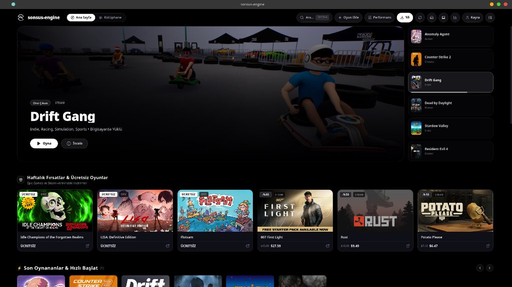
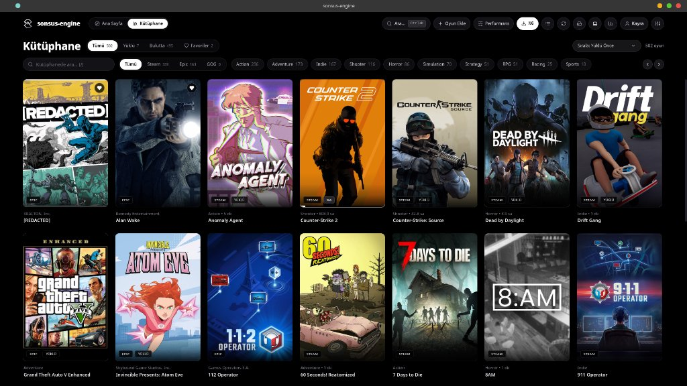

# ⚡ Sonsus Engine

<p align="center">
  <b>E-Spor Odaklı, Sıfır Gecikmeli, Ultra Düşük RAM Tüketen Yeni Nesil Oyun Başlatıcı & Donanım Yöneticisi</b>
</p>

<p align="center">
  
  
  
  
</p>

<p align="center">
    
  <br/><br/>
  
</p>

---

**sonsus-engine**, **Steam**, **Epic Games**, **GOG** ve **Harici / Yerel** oyun kütüphanelerini tek bir yüksek performanslı, `#000000` pitch-black sinematik arayüzde birleştiren; **Tauri v2 (Rust) + React 19 (TypeScript) + Tailwind CSS v4** tabanlı masaüstü oyun kütüphanesi yöneticisi ve donanım kontrol merkezidir.

---

## 🌟 Öne Çıkan Özellikler (`v1.0.0 Final`)

### 🎮 1. HP Victus 15 Donanım & Omen Tuşu Entegrasyonu
- **Akıllı Omen Tuşu (350ms Çift Tıklama Mantığı):**
  - **Tek Tık:** Victus ACPI donanım çipini anında **Performans (Oyun/Turbo Fan)** modu ile **Sessiz/Ofis** modu arasında değiştirir ve KDE masaüstü bildirimi gönderir.
  - **Çift Tık:** Sonsus Engine'i sıfır gecikmeyle açar.
  - **Single-Instance Koruması:** Arka planda uygulama zaten açıksa asla gereksiz yeni pencereler açmaz; mevcut oturumu korur.
- **Canlı Fan & Termal Monitörü:**
  - Canlı CPU sıcaklığı, Fan 1 / Fan 2 gerçek RPM hızları (örn: ~2175 RPM & ~1980 RPM), pil watt tüketimi ve ACPI termal profilleri.

### 🧹 2. Tek Tıkla Disk & Shader Temizleyicisi (Storage Cleaner)
- Steam `shadercache`, GPU Mesa/Nvidia GLCache, Heroic temp ve yetim kalan Wine/Proton `compatdata` kalıntılarını analiz eder.
- Tek tıkla diskten gigabaytlarca (10GB+) gereksiz önbelleği ve çöp dosyaları anında temizler.

### ⚡ 3. Tam Çevrimdışı (Offline) Modu
- İnternet bağlantısı kesildiğinde donma veya takılma yaşanmaz.
- Yerel SQLite WAL veritabanı sayesinde tüm oyun kütüphanesi 0ms gecikmeyle anında ekrana gelir.

### 🏎️ 4. Sıfır Bellek Sızıntısı & Ultra Düşük RAM Tüketimi
- Chromium/Electron launcher'lar (Steam, Heroic) 800MB–1.5GB RAM harcarken, Sonsus Engine **sadece ~69 MB Rust + paylaşımlı WebKit motoruyla** çalışır.
- Tüm I/O ve ağır arka plan işlemleri `tokio::task::spawn_blocking` iş parçacığı havuzuna taşınmıştır; arayüz asla takılmaz (60/144 FPS kilitli).

### 🎯 5. Kütüphane & Oyun Optimizasyonu
- **Proton / GE-Proton Seçici:** Sistemdeki `compatibilitytools.d`, Steam Proton ve Wine sürümlerini otomatik algılar.
- **MangoHud & Gamescope FSR:** Oyun bazlı FPS katmanı ve AMD FSR çözünürlük ölçekleme hook'ları.
- **Tahmini Bitirme Süresi & Canlı CCU:** Oyun detayında Ana Hikaye / %100 Bitirme tahmini süreleri ve anlık eşzamanlı oyuncu sayısı.

---

## 🚀 Kurulum & Çalıştırma

```bash
# Depoyu klonlayın
git clone https://github.com/kayradivrik/sonsus-engine.git
cd sonsus-engine

# İzinleri verin ve başlatın
chmod +x run.sh
./run.sh          # Optimize release ikilisini başlatır
./run.sh --dev    # Canlı geliştirme modunda başlatır
```

### HP Victus 15 Omen Tuşu Servisi (İsteğe Bağlı)
```bash
sudo cp scripts/hp-victus-omen.service /etc/systemd/system/
sudo systemctl daemon-reload && sudo systemctl enable --now hp-victus-omen.service
```

---

## 🛠️ Mimari & Teknolojiler
- **Arayüz:** React 19, TypeScript, Tailwind CSS v4, Lucide Icons, Framer Motion
- **Çekirdek:** Tauri v2, Rust (Tokio async, Rusqlite, Sysinfo)
- **Veritabanı:** SQLite (WAL mode)
- **Tasarım:** Pure Pitch Black (`#000000`) & Zinc Minimalist Aesthetics
