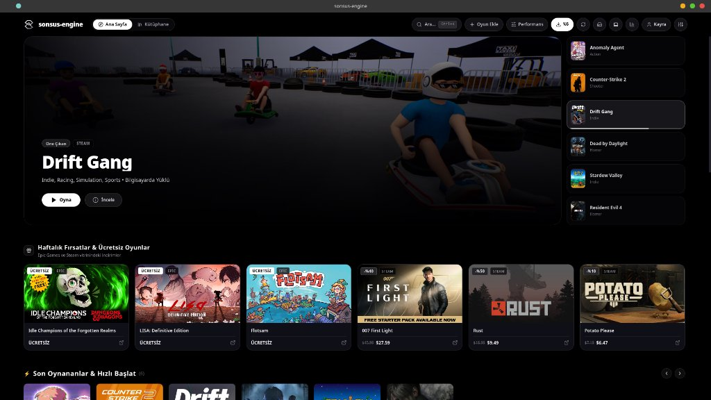
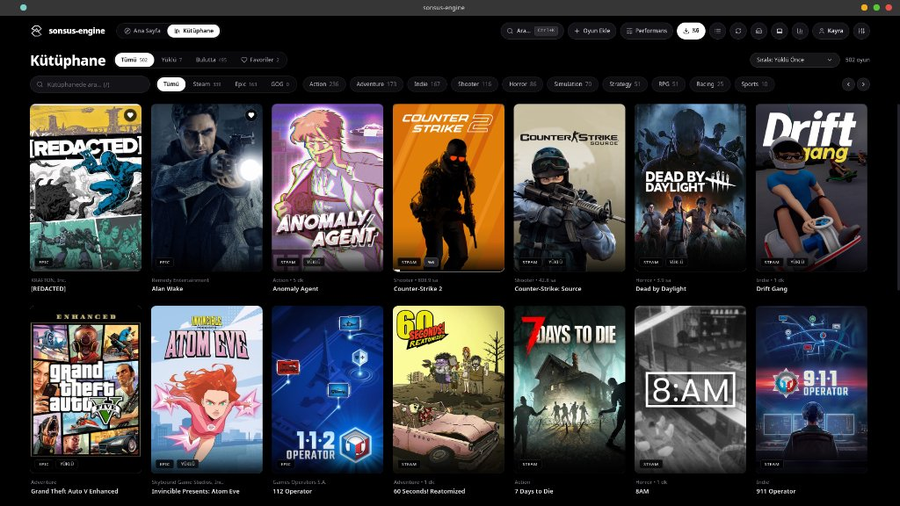
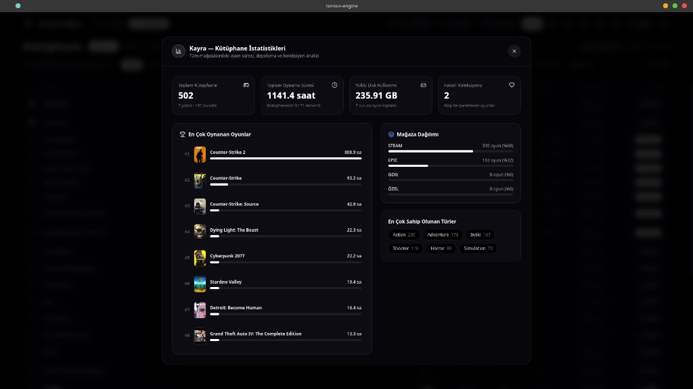

# ⚡ Sonsus Engine

<p align="center">
  <b>Esports-Grade, Zero-Latency, Ultra-Low RAM Next-Gen Game Launcher & Hardware Manager</b><br/>
  <i>E-Spor Odaklı, Sıfır Gecikmeli, Ultra Düşük RAM Tüketen Yeni Nesil Oyun Başlatıcı & Donanım Yöneticisi</i>
</p>

<p align="center">
  <a href="#-english"><b>English</b></a> • <a href="#-türkçe"><b>Türkçe</b></a>
</p>

<p align="center">
  
  
  
  
  
  
</p>

<p align="center">
  
  <br/><br/>
  
  <br/><br/>
  
</p>

---

<a name="-english"></a>
## 🇬🇧 English

**Sonsus Engine** is an ultra-lightweight, high-performance desktop game launcher and hardware optimization hub built on **Tauri v2 (Rust) + React 19 (TypeScript) + Tailwind CSS v4**. It unifies your libraries across **Steam**, **Epic Games**, **Xbox Game Pass (UWP)**, **GOG**, and **Custom Executables** into a single `#000000` pitch-black cinematic interface.

### 🌟 Key Features (`v1.1.0 Esports Edition`)

#### 🎮 1. Multi-Store Unified Library
- **Automatic Detection:** Scans installed games from **Steam**, **Epic Games** (via native Legendary integration), **Xbox Game Pass / Microsoft Store** (`appxmanifest.xml` & `MicrosoftGame.Config`), and **GOG**.
- **Custom Game Support:** Add custom binaries (`.exe`, `.AppImage`, scripts, or emulators) with automated cover art and metadata matching.

#### ⚡ 2. 0.50ms Windows Timer Resolution & Standby RAM Flush (Esports Mode)
- **Ultra-Low Latency:** Uses native NT API (`NtSetTimerResolution`) to lock timer resolution to **0.50ms** for competitive titles (CS2, Valorant, Apex Legends), drastically cutting input lag.
- **Standby RAM Purge:** Instantly flushes Windows working set cache (`EmptyWorkingSet`) to maximize free RAM for demanding games.

#### 🛡️ 3. Windows 11 Debloat & Privacy Manager
- Toggle and batch-clean background telemetry (`DiagTrack`), Bing Start menu search, Cortana, Edge startup services, and Game DVR background recording.
- Equipped with genuine colorful brand logos for Copilot, Edge, Xbox, OneDrive, Cortana, and Windows 11.

#### 📦 4. 1-Click Game Tools & App Store
- Built-in winget repository client to download and install essential gaming tools with one click:
  - **Launchers:** Steam, Epic Games, EA App, Battle.net, GOG Galaxy
  - **Voice:** Discord, TeamSpeak
  - **Hardware & Drivers:** NVIDIA App (RTX 4050/4060/4090), MSI Afterburner, CPU-Z, GPU-Z
  - **Runtimes & Tools:** OBS Studio, 7-Zip, DirectX End-User Runtimes, Visual C++ All-in-One Redistributables

#### 🌐 5. Global Multi-Language Support (i18n)
- Fully translated in 6 languages: **Turkish (TR)**, **English (EN)**, **German (DE)**, **Spanish (ES)**, **French (FR)**, and **Russian (RU)**.
- Automatically recognizes Windows system language.

#### 🧹 6. Storage & Shader Cache Cleaner
- Cleans GPU shader caches (Nvidia GLCache / Mesa), Steam shadercaches, temporary installer files, and orphaned prefixes with a single click.

---

### 🚀 Download & Installation

#### 🪟 Windows 11 (Portable Standalone EXE)
Download the latest precompiled **`SonsusEngine-v1.1.0-Windows-x64.exe`** from [GitHub Releases](https://github.com/kayradivrik/sonsus-engine/releases). No installer or extra dependencies required!

To run from source:
```powershell
# Development Mode (Hot Reload)
.\run.ps1 -Dev

# Build Standalone Release Binary
.\run.ps1 -Build
```

#### 🐧 Linux
```bash
chmod +x run.sh
./run.sh          # Run optimized release binary
./run.sh --dev    # Run development live mode
```

---

<a name="-türkçe"></a>
## 🇹🇷 Türkçe

**Sonsus Engine**, **Steam**, **Epic Games**, **Xbox Game Pass**, **GOG** ve **Özel/Harici** oyun kütüphanelerini tek bir yüksek performanslı, `#000000` pitch-black sinematik arayüzde birleştiren; **Tauri v2 (Rust) + React 19 (TypeScript) + Tailwind CSS v4** tabanlı masaüstü oyun kütüphanesi yöneticisi ve donanım kontrol merkezidir.

### 🌟 Öne Çıkan Özellikler (`v1.1.0 Esports Sürümü`)

#### 🎮 1. Tek Çatı Altında Birleşik Kütüphane
- **Otomatik Tarama:** **Steam**, **Epic Games** (Legendary CLI entegrasyonu), **Xbox Game Pass** (`C:\XboxGames` ve tüm disklerdeki UWP manifestleri) ve **GOG** oyunlarını anında tanır.
- **Harici Oyun Ekleme:** Emülatör veya özel `.exe` oyunlarınızı ekleyebilir, afişlerini otomatik senkronize edebilirsiniz.

#### ⚡ 2. 0.50ms Windows Zamanlayıcı & Boşta RAM Temizleyicisi (Esports Modu)
- **Minimum Giriş Gecikmesi:** `NtSetTimerResolution(5000)` çağrısıyla Windows zamanlayıcı çözünürlüğünü standart 15.6ms'den **0.50ms** seviyesine sabitler; CS2 ve Valorant gibi rekabetçi oyunlarda anlık input lag düşüşü sağlar.
- **Standby RAM Boşaltma:** Arka planda şişen bekleme belleğini (`EmptyWorkingSet`) tek tıkla temizleyerek belleğe ferahlık kazandırır.

#### 🛡️ 3. Windows 11 Debloat & Telemetri Temizleyicisi
- Arka plandaki telemetri (`DiagTrack`), Başlat menüsü Bing araması, Cortana, Edge başlangıç servisleri ve Game DVR video yakalamasını renkli resmi logolarla görsel olarak toplu debloat eder.

#### 📦 4. Tek Tıkla Hızlı Oyun Araçları Deposu
- Winget altyapısıyla temel oyun gereksinimlerini sessizce kurun:
  - **Başlatıcılar:** Steam, Epic Games Launcher, EA App, Battle.net, GOG Galaxy
  - **İletişim:** Discord, TeamSpeak
  - **Donanım & GPU:** NVIDIA App, MSI Afterburner, CPU-Z, GPU-Z
  - **Runtimes & Araçlar:** OBS Studio, 7-Zip, DirectX End-User Runtimes, Visual C++ 2015-2022 All-in-One

#### 🌐 5. 6 Dilli Uluslararası Destek (i18n)
- **Türkçe (TR)**, **İngilizce (EN)**, **Almanca (DE)**, **İspanyolca (ES)**, **Fransızca (FR)** ve **Rusça (RU)** dilleri eksiksiz desteklenir.

#### 🧹 6. Disk & Shader Önbellek Temizleyicisi
- GPU Mesa/Nvidia GLCache, Steam shadercache ve çöp dosyaları analiz ederek tek tıkla gigabaytlarca disk alanı kurtarır.

---

### 🚀 İndirme & Çalıştırma

#### 🪟 Windows 11 (Kurulumsuz Taşınabilir EXE)
[GitHub Releases](https://github.com/kayradivrik/sonsus-engine/releases) sayfasından en son derlenmiş **`SonsusEngine-v1.1.0-Windows-x64.exe`** dosyasını indirin ve çift tıklayarak doğrudan çalıştırın!

Kaynak koddan çalıştırmak için:
```powershell
# Geliştirici Modunda Başlat
.\run.ps1 -Dev

# Optimize Release Sürümü Derle & Başlat
.\run.ps1 -Build
```

#### 🐧 Linux
```bash
chmod +x run.sh
./run.sh          # Optimize release ikilisini başlatır
./run.sh --dev    # Canlı geliştirme modunda başlatır
```

---

## 🛠️ Mimari & Teknolojiler
- **Arayüz (Frontend):** React 19, TypeScript, Tailwind CSS v4, Lucide Icons, Framer Motion
- **Çekirdek (Backend):** Tauri v2, Rust (Tokio Async, Rusqlite, Windows-Sys, Sysinfo)
- **Veritabanı:** SQLite (WAL mode)
- **Tasarım:** Pure Pitch Black (`#000000`) & Zinc Minimalist Estetik
- **Lisans:** MIT License
